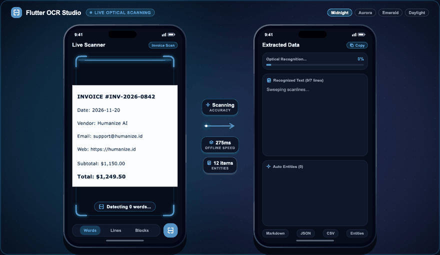

<p align="center">
  
</p>

<p align="center">
  <a href="https://pub.dev/packages/ocr"></a>
  <a href="https://pub.dev/packages/ocr/score"></a>
  <a href="https://github.com/andikpbw/ocr"></a>
  <a href="https://github.com/andikpbw/ocr/blob/main/LICENSE"></a>
  <a href="https://humanize.id"></a>
</p>

# `ocr` — Modern, Lightweight & Accurate Flutter OCR Library

A modern, lightweight, **zero-dependency** Optical Character Recognition (OCR) library for Flutter and Dart. Built from the ground up with a 6-stage computer-vision pipeline, dynamic platform font calibration, structured entity extraction, and a suite of sleek, interactive Flutter UI widgets—**with zero deprecated `package:flutter/material.dart` imports** for seamless compatibility across Flutter 3.32 through Flutter 3.50+ and Dart 3.8–3.14+ (including WebAssembly).

> Supported by **[Humanize AI](https://humanize.id)**

---

## Live UI Showcase

Real, unedited Flutter UI rendered directly by `OcrInspector`, `OcrScannerOverlay`, `OcrResultViewer`, and `OcrEntityChips` running live recognition via `BuiltInOcrEngine`:

<p align="center">
  
</p>

---

## Why `ocr`?

| Feature | Details |
| :--- | :--- |
| **Zero External Dependencies** | Depends strictly on `flutter` SDK (`package:flutter/widgets.dart`). Zero native binary bloat, zero platform-channel breakage, and zero `package:flutter/material.dart` deprecation warnings on Flutter 3.47–3.50+. |
| **All 6 Platforms + Wasm** | Works identically on **Android**, **iOS**, **Web (JS & Wasm)**, **macOS**, **Windows**, and **Linux** without `dart:io` or FFI locks. |
| **6-Stage CV Pipeline** | Rec. 709 luminance, percentile contrast stretch, dark-mode auto-inversion, Otsu / `O(W × H)` integral-image Sauvola & Bradley-Roth binarization, automatic skew correction (±15°), and 8-connectivity Union-Find CCL. |
| **Hybrid Multi-Cue Classifier** | Combines aspect-preserving Gaussian-smoothed ZNCC, positive cosine, 4×4 spatial zoning, 2×2×4 Sobel orientation gradients, Euler interior hole topology, vertical crossing profiles, and line-relative typography—plus automatic runtime platform font calibration. |
| **Smart Entity Extraction** | Automatically extracts **emails**, **URLs**, **dates**, **currency amounts**, **percentages**, **invoice IDs**, **phone numbers**, **card numbers**, **hashtags**, and **`Key: Value` pairs** linked back to bounding boxes. |
| **4 Modern Studio Themes** | Built-in `Midnight`, `Aurora`, `Emerald`, and `Daylight` themes with interactive bounding-box overlays (`Blocks`, `Lines`, `Words`, `Characters`), luminous scan beams, glassmorphic tooltips, and one-tap copy. |
| **Pluggable Backend** | Use the offline `BuiltInOcrEngine` out of the box, or implement `OcrEngine` to plug in native/cloud backends while keeping the exact same models, entity parser, and UI widgets. |

---

## Installation

Add `ocr` to your `pubspec.yaml`:

```yaml
dependencies:
  ocr: ^1.0.0
```

Then run:

```bash
flutter pub get
```

---

## Quick Start

### 1. Recognize Text in 3 Lines

```dart
import 'dart:typed_data';
import 'package:ocr/ocr.dart';

Future<void> scanDocument(Uint8List imageBytes) async {
  // Decodes PNG, JPEG, WebP, GIF, or BMP natively with zero dependencies.
  final OcrResult result = await OcrRecognizer.quickRead(imageBytes);

  print(result.text);
  print('Confidence: ${(result.confidence * 100).toStringAsFixed(1)}%');
  print('Latency: ${result.metrics.processingTime.inMilliseconds}ms');
}
```

### 2. Reusable Recognizer with Domain Presets

```dart
final recognizer = OcrRecognizer(
  config: OcrConfig.receipt(), // Also: .document(), .screenshot(), .digitsOnly(), .fast()
);

final result = await recognizer.recognizeBytes(receiptBytes);

// Traverse full spatial hierarchy: blocks -> lines -> words -> characters
for (final block in result.blocks) {
  for (final line in block.lines) {
    print('${line.text}  @ ${line.boundingBox}');
  }
}

// Access automatically extracted structured entities
for (final entity in result.entities) {
  print('[${entity.type.name}] ${entity.label ?? ''} ${entity.value}');
}

// Export to Markdown, CSV, or pretty JSON
final markdown = result.toMarkdown();
final csv = result.toCsv();
final json = result.toJsonString(pretty: true);

recognizer.dispose();
```

### 3. Camera Streams, Raw Pixels & Widget Capture

```dart
// Android camera YUV420 Y-plane (zero color-conversion overhead)
final camResult = await recognizer.recognizeYuv420(
  yPlane: cameraPlaneBytes,
  width: 1280,
  height: 720,
  bytesPerRow: 1280,
  config: OcrConfig.fast(),
);

// iOS/macOS BGRA8888 or standard RGBA8888 frames
final bgraResult = await recognizer.recognizeBgra(
  bgraBytes,
  width: 1280,
  height: 720,
);

// Capture & OCR any Flutter widget wrapped in a RepaintBoundary
final widgetResult = await recognizer.recognizeWidget(repaintBoundaryKey);

// Continuous stream processing
recognizer.recognizeStream(frameStream).listen((OcrResult frameResult) {
  // Update live HUD
});
```

### 4. Drop-In Modern UI Widgets (Zero `material.dart` Required!)

All UI components rely exclusively on `package:flutter/widgets.dart`, avoiding deprecated Material imports and working cleanly in any Flutter app:

```dart
import 'package:flutter/widgets.dart';
import 'package:ocr/ocr.dart';

Widget buildOcrStudio(Uint8List imageBytes, OcrResult? result, bool scanning) {
  return OcrInspector(
    title: 'Invoice Scanner',
    theme: OcrThemeData.midnight(), // .aurora(), .emerald(), .daylight()
    isScanning: scanning,
    result: result,
    document: Image.memory(imageBytes, fit: BoxFit.contain),
    onEntityTap: (OcrEntity entity) {
      // Handle tapped email, amount, invoice ID, URL, or date
    },
  );
}
```

Or compose individual widgets directly:

- **`OcrScannerOverlay`** — Animated viewfinder with luminous corner brackets, sweeping laser beam, live bounding boxes, and status pill.
- **`OcrResultViewer`** — Pan/zoom interactive document canvas with clickable/hoverable bounding boxes (`Blocks`, `Lines`, `Words`, `Characters`) and floating confidence tooltips with one-tap copy.
- **`OcrEntityChips`** — Category-coded interactive entity chips with crisp custom-painted vector icons.
- **`OcrTheme` / `OcrThemeData`** — Inherited theme configuration with 4 studio presets (`midnight`, `aurora`, `emerald`, `daylight`).

### 5. Custom Pluggable Engine Backend

```dart
class MyCloudOcrEngine implements OcrEngine {
  @override
  String get name => 'MyCloudOcrEngine';

  @override
  Future<OcrResult> recognize(
    OcrImage image, {
    OcrConfig config = const OcrConfig(),
  }) async {
    // Call your preferred native/cloud service and return an OcrResult.
    return OcrResult.empty(imageWidth: image.width, imageHeight: image.height);
  }

  @override
  void dispose() {}
}

final customRecognizer = OcrRecognizer(engine: MyCloudOcrEngine());
```

---

## Processing Pipeline Architecture

1. **Preprocessing (`OcrPreprocessor` & `OcrDeskew`)**
   - Automatic resolution scaling, optional 3×3 median denoising, dark-mode polarity detection & inversion, 1st–99th percentile contrast stretching, automatic Otsu vs. `O(W × H)` integral-image Sauvola / Bradley-Roth binarization, isolated-pixel despeckling, and projection-profile coarse-to-fine deskewing (±15°).
2. **Segmentation (`OcrCcl`, `OcrGlyphSplitter`, `OcrLayoutAnalyzer`)**
   - Two-pass Union-Find 8-connectivity CCL with page-border/rule filtering, within-line multi-part glyph reattachment (`i`, `j`, `!`, `?`, `:`, `;`, `=`, `%`, `"`), touching-glyph vertical-projection valley splitting, dominant-cluster baseline estimation, bimodal adaptive word spacing, and reading-order block grouping.
3. **Recognition & Calibration (`OcrGlyphFeature`, `OcrVectorAtlas`, `OcrFontCalibrator`, `OcrGlyphClassifier`)**
   - Combines an analytical multi-weight & multi-style vector prototype atlas with optional live platform font calibration (`dart:ui` `ParagraphBuilder`, automatically skipping synthetic test fonts). Scores glyphs using 7 complementary visual, topological, and typographic cues.
4. **Post-Processing & Entities (`OcrPostProcessor`, `OcrEntityExtractor`)**
   - Top-K safe contextual disambiguation (`0`/`O`, `1`/`l`/`I`, `5`/`S`, `8`/`B`) followed by regex & layout-backed extraction of 10 structured semantic entity types.

---

## Flutter 3.47–3.50+ / Dart 3.14+ Compatibility

Starting in Flutter 3.47 (and enforced on pub.dev's Flutter 3.50 / Dart 3.14 analysis infrastructure), `package:flutter/material.dart` is deprecated in favor of `package:material_ui/material_ui.dart`.

This package **never imports `package:flutter/material.dart` or `package:flutter/cupertino.dart`** anywhere in `lib/`, `example/`, or `test/`. All widgets are built purely on `package:flutter/widgets.dart` and custom vector painters—giving you zero deprecation warnings, zero third-party design-system lock-in, and full compatibility across both legacy and latest Flutter SDKs.

---

## Support

This library is proudly supported by **[Humanize AI](https://humanize.id)**.

- Support & Sponsorship: **[Humanize AI](https://humanize.id)**
- Source Repository: [github.com/andikpbw/ocr](https://github.com/andikpbw/ocr)
- Issue Tracker: [github.com/andikpbw/ocr/issues](https://github.com/andikpbw/ocr/issues)

---

## License

Released under the [MIT License](LICENSE). Copyright (c) 2026 Humanize AI Indonesia.
